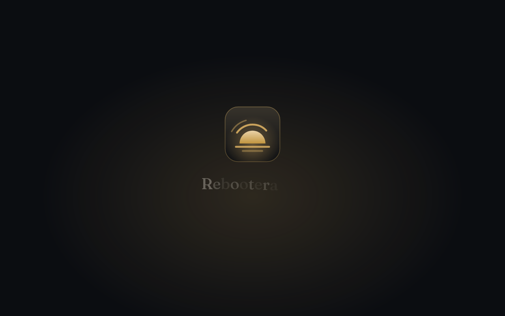
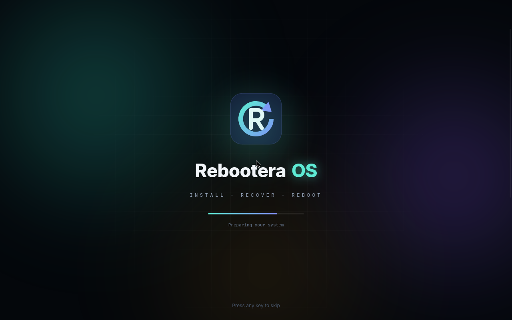
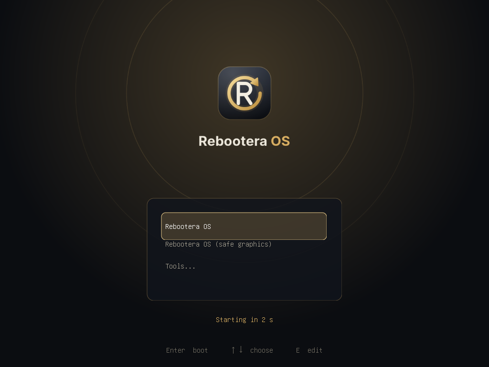
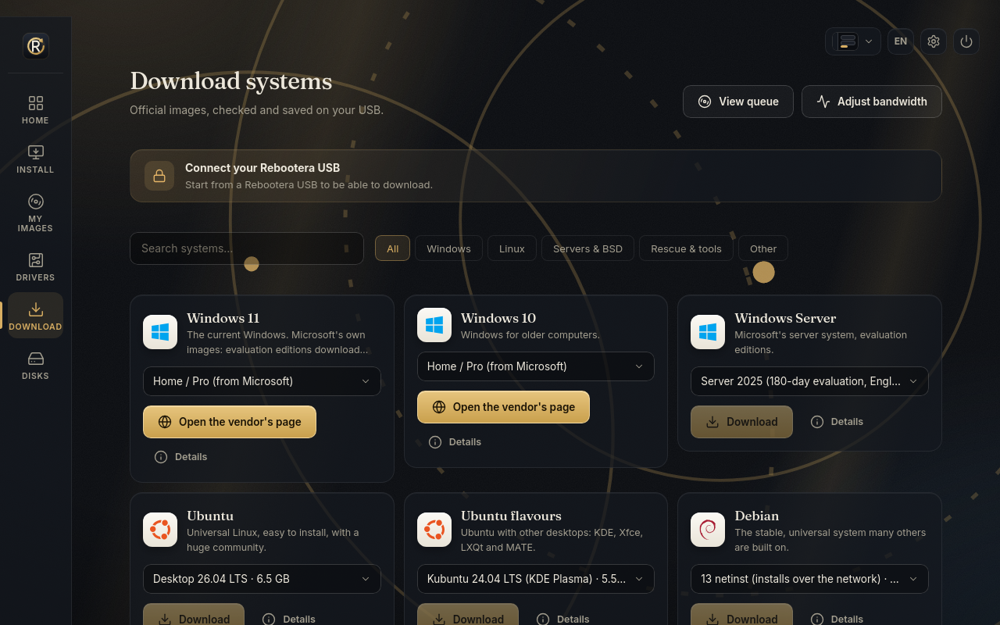
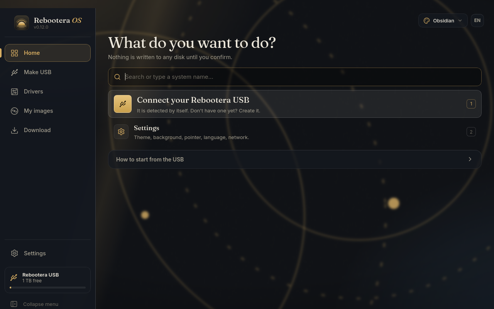

# Rebootera OS

**Instala, recupera y gestiona sistemas operativos desde un solo USB, sin conocimientos técnicos y sin necesitar otro sistema operativo.**

Rebootera OS es un entorno arrancable con identidad e interfaz propias. Conecta el USB de Rebootera a cualquier equipo, arranca desde él y una interfaz guiada a pantalla completa te permite descargar imágenes oficiales, instalar Windows o Linux, revisar el hardware y sus drivers y cuidar tus discos. Una aplicación complementaria, **Rebootera Desktop**, gestiona el mismo USB desde Windows sin reiniciar.

Versión en inglés: [README.md](README.md) · Cambios: [CHANGELOG.es.md](CHANGELOG.es.md)



## Funciones

| Área | Qué hace |
| --- | --- |
| **Arranca en cualquier equipo** | BIOS y UEFI, con Secure Boot mediante el shim firmado de Debian. Menú de arranque, pantalla de arranque e intro animada propios. |
| **Resumen** | Perfil de hardware en vivo: equipo, discos internos y sus particiones, medio de arranque, Secure Boot y TPM, temperaturas, tráfico de red y registro del kernel. |
| **Biblioteca** | Imágenes guardadas en el USB, agrupadas por categoría, con comprobación de integridad SHA-256. Una imagen dañada nunca se ofrece para instalar. |
| **Centro de descargas** | Imágenes oficiales (Ubuntu, Debian, Fedora, Arch Linux, Alpine). El archivo y su suma se obtienen del índice oficial de sumas por HTTPS; las descargas se reanudan tras un corte y solo llegan a la biblioteca si la suma coincide. En Ubuntu, Debian y Fedora, además, la lista de sumas se verifica con la clave GPG oficial del proyecto antes de descargar nada; en Arch Linux y Alpine, que firman cada ISO, se verifica la firma de la propia imagen una vez descargada. |
| **Añadir imágenes** | Desde otro USB o disco (abierto en solo lectura) o, desde Windows, con Rebootera Desktop. Cualquier `.iso` copiada a la carpeta `isos` también aparece. |
| **Asistente de instalación** | Comprobación de requisitos (UEFI, Secure Boot, TPM 2.0, memoria, disco), drivers críticos y disco de destino; después inicia el instalador original desde el menú de arranque. Opcional: responder automáticamente idioma, zona horaria y cuenta de usuario (Windows y Debian; el disco siempre lo eliges tú), llevar al instalador de Windows los drivers que casan, saltarse la comprobación de requisitos de Windows 11 y arrancar el instalador una sola vez (UEFI). |
| **Asistente de drivers** | Todos los dispositivos PCI y USB, el driver de Linux en uso y los Hardware ID de Windows, destacando lo que necesita el instalador (disco y red). También casa esos Hardware ID con los paquetes de drivers de Windows (`.inf`) de la carpeta `drivers/` del USB. |
| **Wi-Fi** | Conecta la sesión a una red inalámbrica desde Ajustes (WPA2/WPA3 y redes abiertas, también ocultas). |
| **USB y discos** | Discos y particiones con su función y su uso. **Safe Disk Guard**: los discos internos y el USB de Rebootera están protegidos y solo se leen. |
| **Discos y particiones** | Cada disco como una barra visual. Cambia el tamaño de una partición, mueve el límite entre dos vecinas con un deslizador, fusiona, borra o crea particiones (ext4 y NTFS se pueden redimensionar sin perder archivos). Cada cambio enseña antes los pasos exactos y pide escribir el nombre del disco; el USB desde el que arranca Rebootera nunca se toca. |
| **Rebootera Desktop** | Aplicación para Windows con una sola opción, **Crear USB**: crea un USB de Rebootera nuevo o actualiza el que ya tienes (sin borrarlo), descargando por ti la última versión de Rebootera OS, y mete en el mismo paso tus imágenes (por ejemplo una ISO de Windows 11 LTSC) y carpetas de drivers, sin mover nada a mano. El Resumen y el Asistente de drivers muestran y gestionan lo que lleva el USB. También descarga imágenes oficiales aunque no haya USB: se guardan en la carpeta `Rebootera` de tu usuario. |
| **Idiomas** | Inglés y español. |

| | |
| --- | --- |
|  |  |
|  |  |

## Cómo conseguir un USB de Rebootera

**Descarga:** la web y las releases públicas (repositorio `Jondals/Rebootera-OS-downloads`; el código fuente es privado) ofrecen siempre la última compilación: `Rebootera-Desktop.exe` para Windows y `rebootera-os-amd64.iso`. Ambas se recompilan en cada push a `master` y se publican en la [release `latest`](https://github.com/Jondals/Rebootera-OS-downloads/releases/tag/latest).

**Canales:** `master` es el canal estable (release `latest`). La rama `beta` se crea sola a partir de la primera release estable y publica la prerelease `beta` en cada push: ahí se prueban los cambios antes de pasarlos a `master`.

**Desde Windows**: ejecuta `Rebootera Desktop.exe` y abre **Crear USB** (es la primera opción). Elige de dónde sale Rebootera OS (*descargar la última versión*, lo recomendado, comprobada con su SHA-256 publicado antes de borrar nada, o *usar una ISO de Rebootera de este PC*), después el pendrive, y escribe la confirmación. Windows pedirá permiso de administrador para preparar el pendrive. Se borra todo el contenido del pendrive elegido; los discos que contienen datos aparecen claramente marcados. Si tu USB ya tiene cosas (por ejemplo, hecho con Rufus), elige **"conservar los archivos"**: Rebootera se añade junto a ellas y no se borra nada. Antes de confirmar puedes **añadir imágenes y carpetas de drivers** (tu Windows 11 LTSC, un Linux, tus drivers de red): se copian en el mismo paso. Si ya tienes un USB de Rebootera, elígelo en la lista: no se borra nada, se puede actualizar Rebootera OS y se copia lo que añadas.

**Desde Linux**, como root:

```bash
scripts/make-usb.sh --device /dev/sdX --confirm /dev/sdX --iso out/rebootera-os-0.8.0-amd64.iso
```

El script rechaza los discos no extraíbles y el disco del sistema.

**Sin persistencia**: la ISO es híbrida, así que también se puede grabar directamente en un pendrive (por ejemplo con Rufus o `dd`) o arrancar desde un DVD. En ese caso Rebootera OS funciona en solo lectura: sin biblioteca ni ajustes guardados.

### Arrancar el equipo desde el USB

1. Conecta el USB y reinicia el equipo.
2. Abre el menú de arranque nada más encender (normalmente F12, F11, F8, F9 o Esc) y elige el USB.
3. Rebootera OS arranca a los pocos segundos.

Con Secure Boot activado, el primer arranque en cada equipo muestra una pantalla azul de MokManager para registrar la clave del menú de arranque: elige **Enroll key from disk**, abre la unidad **VTOYEFI**, selecciona `ENROLL_THIS_KEY_IN_MOKMANAGER.cer`, confirma y reinicia. Solo ocurre una vez por equipo.

> **Compromiso de seguridad:** la política 1 de Ventoy (que rechaza imágenes sin firma comprobada) no deja arrancar Linux con Secure Boot, así que Rebootera usa la política 0. Una vez inscrita la clave, ese equipo también arrancará imágenes cuya firma no se ha comprobado. Inscríbela solo en equipos de confianza y bórrala en MokManager (**Delete MOK**) cuando ya no la necesites.

### Qué hay en el USB

```
REBOOTERA (exFAT)
├─ isos/windows   Imágenes de instalación de Windows
├─ isos/linux     Imágenes de instalación de Linux
├─ isos/tools     Imágenes de rescate y utilidades
├─ drivers/       Paquetes de drivers
├─ tools/         Herramientas portables
├─ files/         Tus archivos
├─ rebootera/     Rebootera OS (no modificar)
└─ ventoy/        Ajustes del menú de arranque (no modificar)
```

## Seguridad

- La interfaz no tiene privilegios. **Rebootera Core** se ejecuta con un usuario sin privilegios y sirve su API solo en `127.0.0.1`, protegida con un token por arranque, comprobación de Host, cabecera anti-CSRF y una política de seguridad de contenido estricta.
- Solo **Rebootera Agent** se ejecuta como root, y acepta una lista cerrada de operaciones únicamente del usuario de Core (comprobado con las credenciales del socket).
- Los demás discos se abren siempre **en solo lectura**, sin reproducir los diarios de los sistemas de archivos.
- Las descargas solo vienen de fuentes oficiales por HTTPS y se comprueban con el SHA-256 oficial antes de llegar a la biblioteca. Cuando el proyecto firma su lista de sumas (Ubuntu, Debian, Fedora), antes se verifica la firma OpenPGP con la clave fijada del proyecto y la descarga se rechaza si no coincide; cuando firma cada ISO (Arch Linux, Alpine), la imagen se verifica tras descargarla y se borra si la firma no coincide.
- Las contraseñas de Wi-Fi nunca salen en una línea de órdenes: van a un perfil de NetworkManager solo de root (0600) que desaparece al desconectar o apagar.
- Los archivos que responden al instalador (con una contraseña codificada) viven en el USB solo hasta que Rebootera vuelve a arrancar, y entonces se borran.
- El menú de arranque no esconde su compromiso de seguridad: con Secure Boot, inscribir la clave de Ventoy permite que ese equipo arranque imágenes sin firma comprobada (la interfaz y este README lo dicen), y los atajos que se saltan los requisitos de Windows 11 están desactivados.

Las limitaciones conocidas están en [docs/LIMITACIONES.md](docs/LIMITACIONES.md).

## Web y compilaciones automáticas

- `site/` es la landing page (HTML sencillo, en español e inglés). `.github/workflows/pages.yml` la publica en GitHub Pages; en los ajustes del repositorio hay que poner una vez **Pages → Source** en *GitHub Actions*.
- `.github/workflows/build.yml` compila la ISO y `Rebootera-Desktop.exe` dentro de un contenedor Debian 13 en cada push a `master` y sustituye la release `latest` por ellos. La web lee de esa release la versión, la fecha y el SHA-256, y Rebootera Desktop descarga de ella la ISO. La primera compilación solo existe tras el primer push.

## Construir

Todo se construye en Windows dentro de una distribución WSL dedicada con Debian 13 llamada `RebooteraBuild`. Las órdenes suponen que el proyecto está en `D:\dev\Rebootera OS`; si está en otro sitio, cambia `/mnt/d/dev/Rebootera OS`. Las dos construcciones necesitan conexión a internet (paquetes de Debian, módulos de Go y paquetes de pnpm).

### 1. Preparar el entorno de construcción (una sola vez)

Abre PowerShell y ejecuta:

```powershell
wsl --install Debian --name RebooteraBuild --location D:\WSL\RebooteraBuild --no-launch
wsl -d RebooteraBuild -u root --exec bash -c "apt-get update && apt-get install -y live-build debootstrap rsync curl golang nodejs node-corepack imagemagick librsvg2-bin grub-common fonts-inter fonts-jetbrains-mono xorriso mtools squashfs-tools dosfstools exfatprogs exfat-fuse gdisk parted qemu-system-x86 qemu-utils ovmf xvfb gir1.2-webkit-6.0 python3-gi"
```

Los seis últimos paquetes solo hacen falta para las pruebas en máquina virtual.

### 2. Construir la ISO

```powershell
wsl -d RebooteraBuild -u root --exec bash "/mnt/d/dev/Rebootera OS/scripts/build.sh"
```

Tarda entre 10 y 20 minutos. El script ejecuta las pruebas de Go, compila `rebootera-core` y `rebootera-agent`, compila la interfaz con pnpm, genera los gráficos del menú y de la pantalla de arranque y ejecuta live-build. El resultado es:

- `out/rebootera-os-<versión>-amd64.iso` y su `.sha256`. Las ISO anteriores de `out/` se borran, así que en `out/` solo hay una ISO.

Para una imagen de pruebas con consola root en el puerto serie, añade `--debug`. Esa imagen se queda dentro de WSL en `/root/rebootera-build/out/` y nunca se mezcla con la definitiva.

### 3. Construir la aplicación de Windows

```powershell
wsl -d RebooteraBuild --exec bash "/mnt/d/dev/Rebootera OS/scripts/build-desktop.sh"
```

Tarda alrededor de un minuto. El script compila la interfaz, la incrusta junto con los archivos de un USB de Rebootera nuevo (ajustes y tema del menú de arranque), añade el icono y el manifiesto de Windows y compila para Windows. El resultado es:

- `out/Rebootera Desktop.exe`: un único archivo, sin instalación. Necesita Microsoft Edge WebView2 Runtime, que ya viene con Windows 10 y 11. Cierra la aplicación antes de volver a construirla.

### 4. Crear un USB de Rebootera

- **Pendrive real**: abre `Rebootera Desktop.exe` → **Crear USB** y elige la ISO del paso 2, o usa `scripts/make-usb.sh --device` en Linux (ver [Cómo conseguir un USB de Rebootera](#cómo-conseguir-un-usb-de-rebootera)).
- **Imagen de disco para máquinas virtuales**: `wsl -d RebooteraBuild -u root --exec bash "/mnt/d/dev/Rebootera OS/scripts/make-usb.sh" --image /root/usb.img --iso "/mnt/d/dev/Rebootera OS/out/rebootera-os-<versión>-amd64.iso"`.

### Desarrollo de la interfaz (pnpm)

```powershell
cd ui
pnpm install
pnpm run format:check
pnpm run check-types
pnpm run build
```

## Pruebas

| Script | Qué comprueba |
| --- | --- |
| `go test ./...` (en `core/`) | Protecciones de la API, inventario de discos y hardware, resolución del catálogo, descargas (reanudación, suma incorrecta), biblioteca, elección del arranque y kit del USB |
| `go test -tags online ./internal/catalog/` | Cada entrada del catálogo contra las fuentes oficiales reales |
| `scripts/test-all.sh [--quick] [--no-build]` | **Todo de una vez**: compila las dos ISO y ejecuta todas las pruebas de VM en paralelo (tres VM de 1,5 GB a la vez). Unos 8 minutos de pruebas; `--quick` arranca las dos ISO en 1 minuto |
| `scripts/cpu-probe.py URL` | CPU en reposo de cada página de la interfaz con el mismo WebKitGTK de la imagen (caza animaciones infinitas) |
| `scripts/vmtest.py MODO ISO SALIDA` | Arranca la ISO en QEMU/KVM (`uefi`, `uefi-sb`, `bios`): servicios, aislamiento, permisos, Secure Boot, capturas de la interfaz y apagado desde ella |
| `scripts/vmtest-v03.py USB.img SALIDA` | Funciones de la 0.3.0 de extremo a extremo: descarga con firma GPG verificada, casado de drivers con INF reales de virtio-win, Wi-Fi con radios simuladas y un punto de acceso virtual, preseed de Debian con arranque único, preparación y limpieza de Windows |
| `scripts/test-desktop-windows.ps1` | Solo Windows: ejecuta el `Rebootera Desktop.exe` real contra un USB **falso** (una carpeta temporal) y comprueba que la imagen y los drivers se copian byte a byte, que el sistema no se toca y que las peticiones malas se rechazan |
| `scripts/make-partman-disk.sh SALIDA.qcow2` | Disco de pruebas del gestor de particiones: ext4 + NTFS con datos y sumas (solo archivos de imagen y un dispositivo loop) |
| `REBOOTERA_LOOP_TESTS=1 go test ./cmd/rebootera-agent -run TestLoop` | Como root en WSL: ejecuta el gestor de particiones sobre discos loop reales (cambiar tamaño, mover un límite en las dos direcciones, fusionar, crear, borrar) y comprueba los archivos por hash y la salud de los sistemas de archivos |
| `scripts/vmtest-interactive.py MODO IMG SALIDA` | Controla una VM desde fuera (teclas, clics, capturas), por ejemplo para recorrer MokManager |
| `scripts/vmtest-usb.py MODO USB.img DISCO.qcow2 SALIDA` | USB de Rebootera de extremo a extremo: Vault, descarga real, importación desde otro disco, ajustes, arranque de la imagen elegida y persistencia tras reiniciar |
| `scripts/ui-preview.py URL SALIDA` | Capturas de la interfaz con el mismo WebKitGTK de la imagen |

Los resultados están en [docs/PRUEBAS.md](docs/PRUEBAS.md).

## Estructura del proyecto

| Carpeta | Contenido |
| --- | --- |
| `branding/` | Logotipo |
| `core/` | Go: `rebootera-core`, `rebootera-agent`, `rebootera-desktop` y sus paquetes |
| `ui/` | Rebootera UI (TypeScript, sin dependencias en tiempo de ejecución) |
| `shell/` | Ventana kiosco (GTK4 + WebKitGTK) que se ejecuta dentro de `cage` |
| `os/` | Configuración de live-build, servicios, menú y pantalla de arranque, contenido del USB de Rebootera |
| `scripts/` | Construcción, creación del USB, gráficos de arranque y pruebas |
| `docs/` | Plan técnico, resultados de las pruebas y limitaciones |

## Componentes de terceros

Rebootera OS se construye sobre Debian GNU/Linux. El USB de Rebootera usa [Ventoy](https://www.ventoy.net) (GPLv3) como capa multiboot, descargado de su release oficial y verificado con el SHA-256 publicado. Rebootera Desktop usa [go-webview2](https://github.com/jchv/go-webview2) (MIT). Fuentes: Inter y JetBrains Mono (SIL Open Font License).
